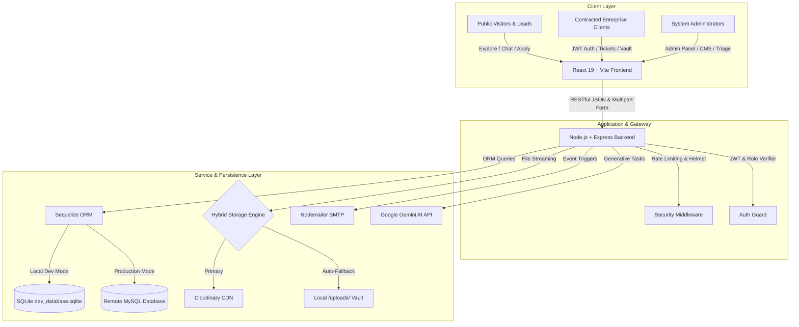

# 🌐 UnioTech IT Solutions — Enterprise Platform & Support Suite

[](https://react.dev/)
[](https://vitejs.dev/)
[](https://tailwindcss.com/)
[](https://nodejs.org/)
[](https://expressjs.com/)
[](https://sequelize.org/)
[](https://ai.google.dev/)
[](https://opensource.org/licenses/ISC)

> **UnioTech IT Solutions Platform** is a full-stack, enterprise-grade IT infrastructure, managed services (AMC), authenticated client helpdesk, and dynamic content management system. It integrates public lead generation, 24/7 AI-driven assistance, multi-tenant client support with live ticket tracking and document repositories, and an administrative operations hub.

---

## 📑 Table of Contents

- [Platform Overview](#-platform-overview)
- [System Architecture](#-system-architecture)
- [Role-Based Feature Matrix](#-role-based-feature-matrix)
  - [1. Contracted Enterprise Client Portal (`/client-portal`)](#1-contracted-enterprise-client-portal-client-portal)
  - [2. Platform Administrator Command Center (`/admin`)](#2-platform-administrator-command-center-admin)
  - [3. Public Corporate Website (`/`)](#3-public-corporate-website-)
- [Key Architectural Highlights](#-key-architectural-highlights)
- [Technology Stack](#-technology-stack)
- [Directory Structure](#-directory-structure)
- [Installation & Local Setup](#-installation--local-setup)
- [Environment Configuration](#-environment-configuration)
- [API Endpoints Overview](#-api-endpoints-overview)
- [Production Deployment Guide](#-production-deployment-guide)
- [License & Authors](#-license--authors)

---

## 🌟 Platform Overview

The platform bridges enterprise corporate marketing with authenticated B2B operations:
1. **Public Marketing & Lead Acquisition**: Showcases managed IT services, cloud migration, server monitoring, and AMC packages. Incorporates Google Gemini AI chatbot for instant technical troubleshooting and visitor engagement.
2. **Contracted Client Portal**: Multi-tenant authenticated portal where corporate clients manage support tickets, upload logs/screenshots up to 25MB, trigger smart urgent nudges, and access central legal contracts/invoices.
3. **Admin Operations Hub**: Command desk for IT managers and executives to triage tickets, dispatch official solutions, manage client accounts, publish dynamic blogs and services, and generate SEO-optimized content via Google Gemini AI.

---

## 🏗️ System Architecture



---

## 👥 Role-Based Feature Matrix

### 1. Contracted Enterprise Client Portal (`/client-portal`)

An isolated, high-security self-service workspace designed for contracted enterprises:

- **🎫 Multi-File Ticket Submission**:
  - Drag-and-drop file uploader supporting images, PDF, and error logs (up to 25MB) with real-time upload progress indicators.
  - Priority levels (`Low`, `Medium`, `High`, `Urgent`) and categorized issue tags.
- **💬 Interactive Ticket Conversation Thread**:
  - Clients can converse directly with IT support engineers, post updates, and attach additional logs to existing open tickets.
- **⚡ Smart Nudge / Escalation**:
  - 1-click urgent escalation button with a 5-minute anti-spam cooldown, triggering immediate alerts to the IT engineering team.
- **✅ Verified Engineer Solution Cards**:
  - Clean resolution cards detailing step-by-step solutions provided by assigned engineers with timestamps.
- **📁 Company Document Vault (`My Documents`)**:
  - Central repository for enterprise contracts, signed Annual Maintenance Contracts (AMCs), monthly SLA reports, and invoices.
  - Client-side search and categorization filter (`Contracts`, `Invoices`, `Reports`, `General`).

---

### 2. Platform Administrator Command Center (`/admin`)

Centralized governance over business leads, client support operations, and dynamic content:

- **📥 Requests & Support Tickets Manager**:
  - Unified tabbed desk: `All Requests`, `Contact Forms`, `Callbacks`, `Enquiries`, `Careers (CVs)`, and `Support Tickets`.
  - Real-time statistics counters (`New`, `In Progress`, `Resolved`, `Total`).
  - Urgent Nudge indicators displaying client reminder counts and timestamps.
  - 1-click CV downloader and ticket attachment inspector.
  - Official solution dispatcher: Saving automatically updates ticket status to `Resolved` and emails formatted HTML solutions to the client.
- **👥 Client Accounts & Company Manager**:
  - Provision enterprise client accounts with custom Company IDs (e.g. `G-TECH`), contact details, and hashed passwords.
  - Associate accounts with AMC tiers (Silver, Gold, Platinum).
- **📋 AMC Plans & Tier Manager**:
  - Dynamic plan builder: SLA response times, on-site visit quotas, 24/7 monitoring tags, and monthly/annual pricing matrices.
- **📝 Dynamic Blog CMS & Google Gemini AI Writer**:
  - Full-featured rich text article editor with Cloudinary cover image integration.
  - Automated clean URL slugs and SEO meta-data generator.
  - Built-in Google Gemini AI assistant to generate structured 1,000-word blog posts and marketing copy in seconds.
- **🧩 Modular Page & Navigation Builder**:
  - Manage dynamic service pages, navigation items, nested dropdown menus, and footer columns directly from the UI without code changes.

---

### 3. Public Corporate Website (`/`)

Conversion-optimized web application engineered for search engines and lead generation:

- **🚀 Corporate Home & Dynamic Service Catalog**:
  - Animated metrics (99.9% uptime, 500+ clients served, 24/7 NOC monitoring).
  - Dynamic service pages (`/services/:slug`) with SLA details, feature grids, and call-to-actions.
  - Interactive AMC plan comparison table with monthly/annual billing toggles.
- **📞 Multi-Channel Lead Acquisition**:
  - **Request a Callback Form**: Select preferred time slots (Morning, Afternoon, Evening).
  - **Free IT Infrastructure Audit Request**: Multi-step audit inquiry capturing company size and server needs.
  - **Public Support Ticket Form (`/support`)**: Emergency inquiry submissions for non-authenticated clients.
- **💼 Careers Portal with Direct CV Upload (`/join-us`)**:
  - Live job vacancy listings with direct multipart CV/resume attachment streaming.
- **🤖 24/7 Google Gemini AI IT Assistant**:
  - Real-time interactive AI chatbot to troubleshoot technical queries, recommend suitable AMC plans, and guide users to book consultations.

---

## ⚡ Key Architectural Highlights

1. **Dual-Database Strategy**:
   - **Zero-Config Local Development**: Automatically uses SQLite (`dev_database.sqlite`) when `NODE_ENV=development`. New developers can clone and run without installing MySQL.
   - **High-Performance Production**: Switches seamlessly to MySQL with connection pooling when `NODE_ENV=production`.
2. **Hybrid Storage Resilience**:
   - Primary file uploads stream to Cloudinary CDN.
   - If Cloudinary credentials are absent or API quotas are exhausted, uploads gracefully fallback to secure local disk storage (`/uploads/`) with zero downtime.
3. **100% SEO Prerendering**:
   - Integrated custom Headless Chrome crawler (`prerender.js`) executes post-build to pre-render dynamic routes into static HTML and automatically regenerates `sitemap.xml`.
4. **Automated Transactional Email Engine**:
   - Nodemailer triggers branded HTML notifications for new tickets, client replies, urgent nudges, engineer solutions, job applications, and lead requests.
5. **Multi-Tenant Security Hardening**:
   - Strict JWT authentication, bcryptjs password hashing, HTTP-only cookie parsing, Helmet security headers, CORS origin verification, and rate limiting.

---

## 💻 Technology Stack

### Frontend
- **Framework**: [React 19](https://react.dev/) + [Vite 7](https://vitejs.dev/)
- **Styling**: [Tailwind CSS v4](https://tailwindcss.com/)
- **Animations**: [Framer Motion](https://www.framer.com/motion/)
- **Icons**: [Lucide React](https://lucide.dev/)
- **Rich Text Editor**: [React Quill New](https://www.npmjs.com/package/react-quill-new)
- **Routing**: [React Router v7](https://reactrouter.com/)
- **SEO & Meta**: [React Helmet Async](https://www.npmjs.com/package/react-helmet-async)
- **AI Integration**: [@google/generative-ai](https://www.npmjs.com/package/@google/generative-ai)
- **Prerendering**: [Puppeteer](https://pptr.dev/) / [@prerenderer/renderer-puppeteer](https://www.npmjs.com/package/@prerenderer/renderer-puppeteer)

### Backend
- **Runtime**: [Node.js](https://nodejs.org/) (v16+)
- **Server Framework**: [Express 4](https://expressjs.com/)
- **ORM**: [Sequelize v6](https://sequelize.org/)
- **Databases**: SQLite3 (Local Dev) / MySQL2 (Production)
- **Authentication**: JSON Web Tokens (`jsonwebtoken`) + `bcryptjs`
- **File Handling**: [Multer](https://github.com/expressjs/multer) + [Cloudinary](https://cloudinary.com/)
- **Email Service**: [Nodemailer](https://nodemailer.com/)
- **Security & Performance**: [Helmet](https://helmetjs.github.io/), [CORS](https://expressjs.com/en/resources/middleware/cors.html), [Compression](https://www.npmjs.com/package/compression), [Express Rate Limit](https://www.npmjs.com/package/express-rate-limit)

---

## 📂 Directory Structure

```text
UNIOTECH_M/
├── backend_s/                        # Node.js + Express Backend API
│   ├── config/                       # Database & Cloudinary config
│   ├── middleware/                   # JWT Auth, Upload, Rate Limiting middleware
│   ├── models/                       # Sequelize DB models (Submission, Client, Document, etc.)
│   ├── routes/                       # REST API route handlers
│   ├── services/                     # Email, AI & auxiliary services
│   ├── utils/                        # Validation & SLA helpers
│   ├── app.js                        # Express server entry point
│   ├── .env.example                  # Backend environment template
│   └── package.json                  # Backend dependencies
│
├── frontend_old/                     # React 19 + Vite Frontend
│   ├── public/                       # Static public assets, robots.txt, sitemap
│   ├── src/
│   │   ├── components/               # AdminPanel, LiveChat, Navigation, Modals
│   │   ├── context/                  # Global Context (Auth, Content, Theme)
│   │   ├── pages/                    # Home, ClientPortal, Services, Pricing, Blogs, Careers
│   │   ├── App.jsx                   # Application layout & routing
│   │   └── main.jsx                  # React DOM root entry
│   ├── index.html                    # Root HTML template
│   ├── prerender.js                  # Headless crawler for SEO prerendering
│   ├── vite.config.js                # Vite build configuration
│   ├── .env.example                  # Frontend environment template
│   └── package.json                  # Frontend dependencies
│
├── UnioTech_Project_Documentation.md # Detailed technical role & workflow manual
├── .env.example                      # Unified monorepo environment reference
├── .gitignore                        # Global repository ignore rules
├── package.json                      # Monorepo task orchestration scripts
└── README.md                         # Main repository documentation
```

---

## 🚀 Installation & Local Setup

### Prerequisites
- **Node.js**: v18.0.0 or higher
- **npm**: v9.0.0 or higher
- **Git**

### Step 1: Clone Repository
```bash
git clone https://github.com/aurav2001/UNIOTECH_M.git
cd UNIOTECH_M
```

### Step 2: Install Dependencies
You can install dependencies for both frontend and backend using the root script:
```bash
npm run install:all
```
*(Or install separately in each folder: `cd backend_s && npm install` and `cd ../frontend_old && npm install`)*

### Step 3: Configure Environment Variables

**Backend (`backend_s/.env`):**
```bash
cp backend_s/.env.example backend_s/.env
```
*(For local testing, defaults work immediately with SQLite!)*

**Frontend (`frontend_old/.env`):**
```bash
cp frontend_old/.env.example frontend_old/.env
```
*(Optionally add your `VITE_GEMINI_API_KEY` for AI features)*

### Step 4: Run the Application

In two separate terminals:

**Terminal 1 (Backend API):**
```bash
npm run dev:backend
# API starts on http://localhost:5000 (Uses SQLite dev_database.sqlite automatically)
```

**Terminal 2 (Frontend Client):**
```bash
npm run dev:frontend
# Vite development server starts on http://localhost:5173
```

Open [http://localhost:5173](http://localhost:5173) in your browser to view the application!

---

## ⚙️ Environment Configuration

### Backend Reference (`backend_s/.env`)
| Variable | Description | Default / Example |
| :--- | :--- | :--- |
| `PORT` | API Server Port | `5000` |
| `NODE_ENV` | Environment (`development` or `production`) | `development` |
| `ADMIN_PASSWORD` | Initial Administrative Portal Password | `admin123` |
| `JWT_SECRET` | Secret key for signing JSON Web Tokens | Minimum 32-char string |
| `FRONTEND_URL` | Allowed CORS origins (comma-separated) | `http://localhost:5173,http://localhost:4173` |
| `DB_HOST` | Production MySQL Database Host | `localhost` |
| `DB_NAME` | Production MySQL Database Name | `uniotech_db` |
| `DB_USER` | Production MySQL Database User | `root` |
| `DB_PASS` | Production MySQL Database Password | `password` |
| `EMAIL_HOST` | SMTP Server Host | `smtp.yourdomain.com` |
| `EMAIL_PORT` | SMTP Port | `465` (SSL) or `587` (TLS) |
| `EMAIL_USER` | SMTP Username / Email | `support@yourdomain.com` |
| `EMAIL_PASS` | SMTP Password / App Password | `app_password` |
| `CLOUDINARY_*` | Cloudinary CDN Credentials *(Optional)* | Cloud Name, API Key, Secret |

### Frontend Reference (`frontend_old/.env`)
| Variable | Description | Default / Example |
| :--- | :--- | :--- |
| `VITE_API_URL` | Base URL of the backend API | `http://localhost:5000` |
| `VITE_GEMINI_API_KEY` | Google Gemini AI API key | `AIzaSy...` |

---

## 📡 API Endpoints Overview

| Method | Endpoint | Access | Description |
| :--- | :--- | :--- | :--- |
| `POST` | `/api/auth/login` | Public | Administrator login |
| `GET` | `/api/submissions` | Admin | Retrieve all tickets, callbacks, and leads |
| `PUT` | `/api/submissions/:id` | Admin | Update status / dispatch official engineer solution |
| `POST` | `/api/submissions/contact` | Public | Submit contact form |
| `POST` | `/api/submissions/callback` | Public | Request a priority sales callback |
| `POST` | `/api/submissions/career` | Public | Apply for a job opening with CV upload |
| `POST` | `/api/client/login` | Client | Authenticate client portal user |
| `POST` | `/api/client/tickets` | Client | Create a support ticket with multi-file uploads |
| `POST` | `/api/client/tickets/:id/reply` | Client | Add comment / additional attachments to ticket |
| `POST` | `/api/client/tickets/:id/nudge`| Client | Send urgent nudge / escalation to admin |
| `GET` | `/api/client/documents` | Client | Fetch client company legal & SLA documents |
| `POST` | `/api/client/documents` | Client | Upload company document to vault |
| `GET` | `/api/blogs` | Public | Fetch published SEO blog articles |
| `POST` | `/api/blogs` | Admin | Create new blog post |
| `GET` | `/api/pages/:slug` | Public | Fetch dynamic modular page configuration |
| `GET` | `/api/content/:section` | Public | Fetch navbar, footer, or AMC plan data |

---

## 🚢 Production Deployment Guide

### Option 1: cPanel Deployment
1. Run `npm run build` inside `frontend_old`.
2. Upload the generated contents of `frontend_old/dist/` to `public_html/`.
3. In cPanel **Setup Node.js App**, create an application pointing to `backend_s/app.js`.
4. Upload `backend_s/` (excluding `node_modules`).
5. Run **Run NPM Install** in cPanel and configure production `.env` with MySQL credentials.

### Option 2: VPS / Ubuntu (Nginx + PM2)
1. Install Node.js, PM2, and Nginx.
2. Clone repository to `/var/www/uniotech`.
3. Build frontend:
   ```bash
   cd frontend_old && npm install && npm run build
   ```
4. Start backend with PM2:
   ```bash
   cd ../backend_s && npm install
   NODE_ENV=production pm2 start app.js --name "uniotech-backend"
   pm2 save
   ```
5. Configure Nginx to serve `frontend_old/dist` as static root and proxy `/api` requests to `http://127.0.0.1:5000`.

---

## 📄 License & Authors

- **Developed by**: Gaurav Pandey ([@aurav2001](https://github.com/aurav2001))
- **Project**: UnioTech IT Solutions Enterprise Platform
- **License**: ISC License

---
*Built with modern standards, high security, and performance-first architecture.*
